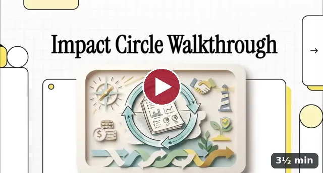

  <a href="https://narissa-pgm.github.io/AAD/career-profile.html"><b>Interactive career profile</b></a> ·
  <a href="https://narissa-pgm.github.io/AAD/fas-stewardship.html">FAS pilot brief</a> ·
  <a href="https://narissa-pgm.github.io/AAD/operations.html">How it runs</a> ·
  <a href="https://narissa-pgm.github.io/AAD/donor-profile.html">Donor record</a> ·
  <a href="https://www.linkedin.com/in/narissara/">LinkedIn</a> ·
  <a href="mailto:Narissa.K9@proton.me">Narissa.K9@proton.me</a> ·
  Cambridge, MA

## At a glance

| | |
|---|---|
| **Most recent institutional role** | Faculty Affairs Data Owner, Harvard FAS Office for Faculty Affairs · April 2019 – November 2025 |
| **Now** | Data Analytics & Reporting Practitioner, independent practice (remote) · 2008–present, concurrent with institutional roles |
| **Focus** | Faculty affairs operations, financial stewardship, governed reporting, responsible AI |
| **Open to** | Academic operations and advancement reporting leadership |

## Watch the work

<table>
<tr>
<td width="50%" valign="top"> <b>Impact Circle · Stewardship Hub walkthrough</b> How One Harvard partners, the seven-stage Impact Circle, SMARTER gates and VERITAS reports fit together. <a href="https://narissa-pgm.github.io/AAD/impact-circle.html">Open the hub ↗</a></td>
<td width="50%" valign="top"> <b>Donor thank-you story · sample</b> A stewardship video for an endowed Ph.D. fellowship, with the email that delivers it. Donor, fund and student are fictional. <a href="https://narissa-pgm.github.io/AAD/donor-profile.html#story-email">See the email and the Release Gate review ↗</a></td>
</tr>
</table>
AI-narrated with Google NotebookLM from my own sources.

## Career and role mix

Select a role for its responsibilities.

<b>Data Analytics &amp; Reporting Practitioner</b> · Independent Practice — Remote · 2008 – Present

- Maintain an independent, remote practice in data analytics, report writing, and reporting solutions for advancement, finance, and operational clients (2008–present).
- Design Crystal Reports and SQL-based reporting assets, including parameterized reports, scheduled output, dashboards, and reusable templates clients can use without ongoing analyst support.
- Analyze trends, benchmarks, KPIs, audience segments, and performance using SQL, Excel, Tableau, and Power BI.
- Translate business requirements into reporting specifications, technical documentation, database views, and workflow requirements.
- Develop and optimize SQL queries, views, and stored procedures across Oracle and Microsoft SQL Server.
- Run acceptance tests, smoke tests, and critical-user-journey walkthroughs before release, verifying data integrity, calculations, model quality, visual clarity, accessibility, interaction, security, delivery, and handoff.
- Audit deliverables for executive decision value and industry relevance; rework or retire outputs that fail the value test.
- Stress-test reports, queries, and financial reconciliations against edge cases, peak volumes, and incomplete source data; document defects, findings, and corrective actions.
- Apply Lean Six Sigma methods—process mapping, root-cause analysis, cycle-time and defect measurement, and standardized SOPs—to improve and sustain reporting workflows.
- Build governed self-service resources with standardized metrics, refresh cadences, and validation checks to reduce ad hoc reporting demand.

<b>Faculty Affairs Data Owner</b> · Harvard University, FAS Office for Faculty Affairs · April 2019 – November 2025

- **Faculty affairs advising · 35%.** Reporting for appointments, promotions, and reviews. Primary technical advisor to 50+ department chairs, with materials for FAS deans, visiting committees, and the Office of the Governing Boards. Wrote the back-end pull reports in SQL, Python, R and Crystal Reports for ad-hoc requests from 50+ departments.
- **Appointments and promotions · 25%.** Redesigned appointment and promotion workflows, and supported faculty searches and offer letters.
- **DataHub pilot and sponsored research · 25%.** Piloted the FAS DataHub (Oracle BI / HART), joining FAS sources including Finance with external benchmarks such as IPEDS, COFHE and Ivy Plus, a team effort that used my reports as its blueprint, serving FAS Finance, the Office of the Governing Boards, the Graduate School and Harvard College; GMAS reports joined to faculty and finance, in an FAS operation of more than $1 billion a year with 20+ years of longitudinal data. Moved self-service reporting from APEX to HART, from one office to deans, chairs and department administrators. Ad hoc requests fell from about 300–400 a year to under 100.
- **Team leadership · 15%.** Workflow and quality control across two teams of three, with source-to-target tie-outs and documented assumptions.

<b>Assistant Director of Gift Services &amp; Reporting</b> · Phillips Academy, Andover · August 2016 – April 2019

- **Campaign analytics · 40%.** Financial analytics and leadership pacing reports for a $400 million comprehensive campaign.
- **General Ledger bridge · 30%.** Financial bridge reconciliations to the General Ledger with the Comptroller’s office.
- **Controls and procedures · 20%.** Repeatable procedures that reduced reporting discrepancies and strengthened audit-ready evidence.
- **Conversion and reporting systems · 10%.** Converted from Raiser’s Edge to Agilon, digitizing paper records with 10 years of history back-entered. Reporting in SQL Server, SSRS, Crystal Reports, and Tableau.

<b>Associate Director of Donor Records and Advancement Information Service</b> · U of AR for Medical Sciences, Little Rock · May 2008 – July 2016

- **60K profile/data management · 35%.** Constituent and donor profiles, duplicate controls, data-quality review, and reporting other teams could trust.
- **20K+ annually · 30%.** Advancement transactions a year, including online giving, exceptions, and cash reconciliation.
- **Conversion and online giving · 20%.** Converted from Raiser’s Edge to SunGard Advance (now Ellucian Advance), digitizing paper records with 10 years of history back-entered. Piloted and managed online giving, front end and back end, with exception resolution and record-quality checks.
- **Staff supervision and SQL · 15%.** Hired, supervised, and reviewed donor-records staff. Oracle SQL views, stored procedures, and data-quality queries.

<b>Research and program support</b> · U of AR for Medical Sciences, Little Rock · 2005 – 2008

- **PI research support · 45%.** In the College of Medicine: grant proposals, budgets, effort and salary distributions, award documents, and sponsor reports, drafted for the principal investigator’s approval. Pioneered the needs assessment behind the ANGELS telemedicine proposals, which helped secure $5.25 million (2007) and $5.84 million (2008).
- **College of Medicine · 30%.** 360° evaluations, program assessments, and visualizations for senior directors.
- **College of Pharmacy · 25%.** Programmatic assessments and account reconciliations in SharePoint and Blackboard.

<b>Global communications &amp; e-commerce</b> · UNCTAD Trade Point Chiang Mai, Thailand. · 2002 – 2005

- **Trade Point operations · 100%.** Global communications, e-commerce, conference operations, and translation.

## Conversions and results

## Operating model · proposed for stewardship reporting

**Automation takes the repetitive work. People keep every decision.** One Harvard means coordinating without formal authority: offices share the automation and the standards, and each office keeps its own decisions.

Green steps run on a schedule; red steps are always a person; the gold loop turns each cycle's reason codes into next cycle's rules. <a href="https://narissa-pgm.github.io/AAD/operations.html#weekly-loop">See how it runs, step by step ↗</a>

**See it working, in four pages:** [Career profile](https://narissa-pgm.github.io/AAD/career-profile.html) · [FAS pilot brief, piloted on the Ph.D. fellowship funds](https://narissa-pgm.github.io/AAD/fas-stewardship.html#fellowship) · [How it runs](https://narissa-pgm.github.io/AAD/operations.html#weekly-loop) · [Donor record and Release Gate](https://narissa-pgm.github.io/AAD/donor-profile.html) · older work: [detail by section](https://narissa-pgm.github.io/AAD/archive.html)

Portfolio scope: an independent proposed approach aligned with One Harvard principles, not an official Harvard policy or a deployed system. Partner offices, report and donor examples are illustrative.

## Credentials and toolkit

**Certifications:** QPS Master Expert Certification — AI Execution (including generative AI and AI tools) · AI Project Management · AI Marketing and Business Development · Data Analytics · AI for Data Analysis

**Education:** B.A., English, Linguistics and Literature, minor in German · Payap University, Chiang Mai · Graduate coursework, Nonprofit Management, University of Arkansas at Little Rock (15 credit hours, not a completed degree)

| Area | Tools |
|---|---|
| Data and code | SQL · Oracle SQL · SQL Server · Python · R · Excel |
| Reporting and BI | Oracle BI / HART · APEX · Crystal Reports · SSRS · Tableau · Power BI |
| Advancement systems | SunGard / Ellucian Advance · Blackbaud Raiser's Edge · Agilon · iModules · CyberSource · iGiving |
| University systems | Aurora · GMAS · FROPS · SIS · GSAS BI Data Warehouse · PeopleSoft · Workday |
| AI practice | Generative AI · AI execution · AI project management · Responsible AI · Prompt engineering |

---

> *A stewardship report is a promise kept in writing: the gift did what was intended, the amount agrees with Finance, and the impact is one the institution can stand behind.*

<a href="mailto:Narissa.K9@proton.me"><b>Start a conversation</b></a> · <a href="https://narissa-pgm.github.io/AAD/career-profile.html">Open the interactive career profile</a>

